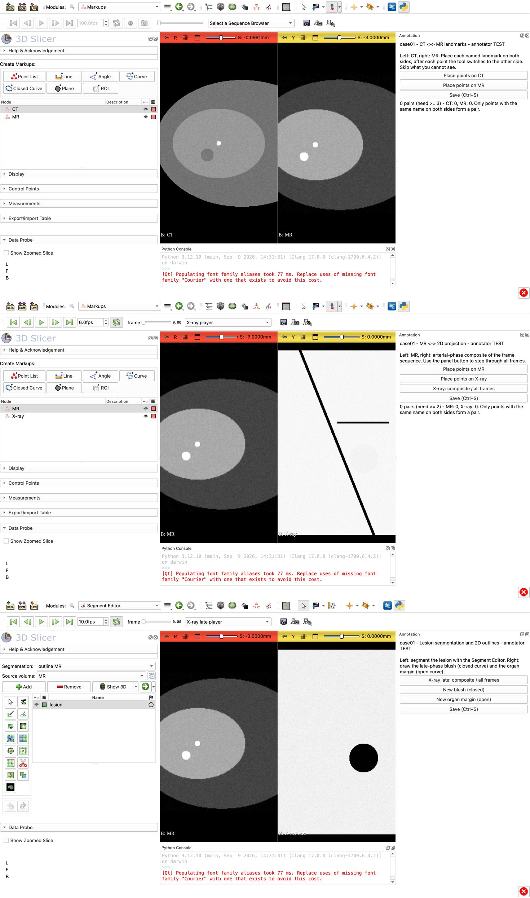

# slicer-blind-annotate

Blind, paired annotation for multimodal registration studies, in [3D Slicer](https://www.slicer.org/).

[中文说明](README_zh.md)

Evaluating a registration method needs reference annotations made **on the original images**, by people who
**have not seen the registration result**. This tool turns that protocol into a one-command workflow:

- Two side-by-side views per task. Each view shows one image: a 3D volume (CT, MR, ...) or a 2D projection
  built from a frame sequence (DSA, fluoroscopy, X-ray). Only images listed in the config are loaded.
- Each view carries one kind of annotation: **named points**, a **segmentation**, or **curves**.
- When both views carry points, they are annotated as **corresponding pairs**: after a point on one side the tool
  switches to the same name on the other side. A point accidentally placed in the wrong view is undone.
- Results are saved as plain JSON / NIfTI in patient (LPS) coordinates for volumes and pixel coordinates
  (column, row, optional frame) for projections. Reopening a case resumes the saved annotation.
- A status command reports progress per annotator and lists a fixed subset for second-annotator re-annotation.



## Requirements

3D Slicer 5.6 or later (tested on 5.12). No extensions or extra packages: the tool is a single Python file.

## Quick start

```bash
# 1. synthetic demo data (two cases)
/Applications/Slicer.app/Contents/bin/PythonSlicer examples/make_demo_data.py
# 2. open a task
/Applications/Slicer.app/Contents/MacOS/Slicer --python-script blind_annotate.py examples/demo_config.json case01 landmarks --annotator A
# 3. progress (any Python 3)
python3 blind_annotate.py status examples/demo_config.json --annotator A
```

On Linux/Windows replace the paths with your Slicer executable (`Slicer` / `Slicer.exe`).
Save with **Ctrl+S** (Cmd+S is not bound) or the *Save* button.

## Config

```json
{
  "cases_root": "data",                    // relative to the config file; one sub-folder per case
  "output": "annotations/{annotator}",     // relative to each case folder
  "reannotate_every": 5,                   // optional: every 5th case (sorted) for a second annotator
  "cases": ["case01", "case02"],           // optional: default = all sub-folders of cases_root
  "tasks": {
    "<task name>": {
      "title": "...", "instructions": "...", // shown in the side panel
      "min_pairs": 3,                        // optional, shown in the status line
      "link_views": false,                   // optional: link scrolling of the two views
      "left":  { <view> },
      "right": { <view> }
    }
  }
}
```

A **view** has an image and at most one annotation type:

| key | meaning |
|---|---|
| `title` | name shown in the UI and in the output |
| `image` | 3D volume path (anything Slicer reads: NIfTI, NRRD, ...) |
| `projection` | 2D image built from a frame sequence, see below |
| `window` | optional `[width, level]` |
| `start_at_mask` | optional mask; the view opens at the slice through its centroid (e.g. the organ in a long CT) |
| `points` | list of point names |
| `segments` | list of segment names; edited with the Segment Editor |
| `curves` | list of `{"key", "title", "closed"}`; any number of curves of each kind |

`projection`:

| key | meaning |
|---|---|
| `file` | `.npz` / `.npy` array `(frames, rows, cols)`, or any image SimpleITK reads (e.g. a multi-frame DICOM) |
| `key` | array name inside an `.npz` (default `frames`) |
| `composite` | `min`, `max`, `mean` or `first` over the selected frames (`min` = darkest, i.e. most contrast in subtracted angiography) |
| `frames` | `[first, last]` (inclusive) |
| `pixel_spacing` | mm per pixel; default from the image file, else 1 |
| `frame_rate` | playback rate for stepping through all frames |

Any of `frames`, `pixel_spacing` and `frame_rate` can be read per case from a file in the case folder:
`{"file": "meta.json", "key": "pixel_mm"}`, or `{"file": "info.npz", "key": "windows", "index": [1, 2]}` to take
two elements of an array. The panel button *composite / all frames* switches between the composite and the full
sequence (played with Slicer's Sequences toolbar).

See [examples/demo_config.json](examples/demo_config.json) and
[examples/liver_tace_mr_ct_dsa.json](examples/liver_tace_mr_ct_dsa.json) (CT/MR landmarks, MR/DSA branch points,
tumour and DSA outlines, hepatic artery segmentation).

## Output

In `<case>/<output>/`:

- `<task>.json`
  ```json
  {"case": "case01", "task": "landmarks", "annotator": "A", "saved": "...", "tool_version": "0.1.0",
   "pairs": ["vessel entry"],
   "views": {
     "left":  {"title": "CT", "kind": "volume", "points": {"vessel entry": {"lps": [10.0, -20.0, 30.0]}}},
     "right": {"title": "X-ray", "kind": "projection",
               "points": {"vessel entry": {"uv": [300.0, 200.0], "frame": null}},
               "curves": {"blush": [[{"uv": [100, 100]}, {"uv": [200, 120]}, ...]]}}}}
  ```
  `lps`: patient coordinates in mm (DICOM convention, same as SimpleITK). `uv`: pixel column and row in the
  original frame; `frame` is set when the point was placed while showing all frames.
- `<task>_<left|right>.nii.gz`: segmentation as a label map on the grid of that view's image
  (labels 1..n in the order of `segments`), plus `.seg.nrrd` used to resume.

## Tests

```bash
Slicer --no-splash --python-script tests/test_in_slicer.py   # writes tests/result.txt
```

Generates the demo data if needed, then checks coordinate round trips, pixel values of the composite,
pairing, resume, segmentation geometry and the wrong-view guard.

## Notes on blinding

The tool loads only what the config lists. Keep derived data (registration outputs, predictions) out of those
paths, and give each annotator their own `--annotator` code so outputs never mix.

## License

MIT
